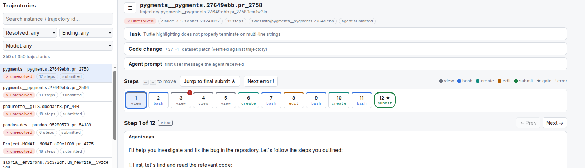

# Work test submission: commit-first review gate for a coding agent

## Beginning screenshot

TODO: add the screenshot (drag the image into the gist on github.com after creating it, or paste a link here).

## Code

- Repository: https://github.com/reinthal/pivotal-winter-2027
- Gate extension (Part A): https://github.com/reinthal/pivotal-winter-2027/blob/main/extensions/commit-first/index.ts
- Recorded run → replay events: https://github.com/reinthal/pivotal-winter-2027/blob/main/scripts/convert_runs.py
- Good-runs subset builder: https://github.com/reinthal/pivotal-winter-2027/blob/main/scripts/build_subset.py
- Trajectory viewer: https://github.com/reinthal/pivotal-winter-2027/blob/main/scripts/serve_viewer.py
- Tagging eval (Inspect): https://github.com/reinthal/pivotal-winter-2027/blob/main/evals/trajectory_audit.py
- Data problems and how to run everything: https://github.com/reinthal/pivotal-winter-2027/blob/main/README.md
- Decisions and why: https://github.com/reinthal/pivotal-winter-2027/blob/main/summary.md

## Part B: study design

TODO: paste the Part B write-up (about 500 words).

## Walkthrough recording

TODO: add the link to the recording (viewable by anyone with the link).

## AI use

Built with Claude Code. Session: https://claude.ai/code/session_01HnrN8eYf5ygQpnRPrfvRug
